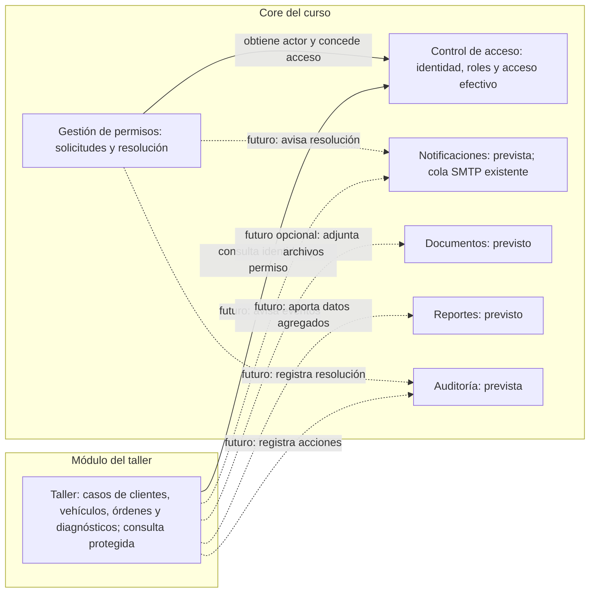

# TallerOS

Sistema de gestión para un solo taller de automóviles y motocicletas. Incluye Control de acceso, Gestión de permisos y el dominio y casos de uso del taller con pruebas unitarias y de persistencia. Las operaciones HTTP del taller incluyen clientes, vehículos, órdenes, diagnósticos y avance de reparación con autorización en servidor. La API usa C# y ASP.NET Core 10, Entity Framework Core y SQLite. React se incorporará en una etapa posterior.

## Requisitos y ejecución desde un clon

1. Instala el SDK de .NET 10 y clona este repositorio. Ejecuta los comandos desde la raíz `TallerOs`.
2. Ejecuta `dotnet restore TallerOs.slnx` y `dotnet build TallerOs.slnx`.
3. En PowerShell, crea un Administrador inicial con un correo distinto del que usarás para probar el registro:

   ```powershell
   $env:ADMIN_EMAIL = Read-Host 'Correo del Administrador'
   $secure = Read-Host 'Contraseña del Administrador' -AsSecureString
   $env:ADMIN_PASSWORD = [System.Net.NetworkCredential]::new('', $secure).Password
   dotnet run --project src/TallerOs.Api --no-launch-profile -- bootstrap-admin
   Remove-Item Env:ADMIN_PASSWORD
   ```

   La contraseña debe tener al menos ocho caracteres, letras y números. Este comando solo crea el primer Administrador; si ya existe uno, no crea otro.

4. En la misma terminal, inicia la API:

   ```powershell
   $env:APP_BASE_URL = 'http://localhost:5000'
   dotnet run --project src/TallerOs.Api --no-launch-profile --urls http://localhost:5000
   ```

   Abre `http://localhost:5000/health`. Debe responder `{"status":"ok"}`. La base SQLite se crea en `data/talleros.db`, fuera del control de versiones. Al reiniciar la API conserva usuarios y correos. `DB_PATH` permite elegir otra ruta.

5. Abre **otra** terminal PowerShell en la raíz del repositorio para las peticiones. El correo se envía con el comando independiente `send-mail` descrito abajo.

## Variables de entorno

| Nombre | Para qué sirve |
| --- | --- |
| `DB_PATH` | Ruta opcional de la base SQLite; por defecto `data/talleros.db`. Usa la misma ruta en la API y en los comandos. |
| `APP_BASE_URL` | Dirección pública de la API usada en los enlaces de activación. |
| `ADMIN_EMAIL` | Correo del primer Administrador, usado solo por `bootstrap-admin`. |
| `ADMIN_PASSWORD` | Contraseña del primer Administrador, usada solo por `bootstrap-admin`. |
| `SMTP_HOST` | Servidor SMTP que entrega los correos. |
| `SMTP_PORT` | Puerto SMTP; por defecto 587. |
| `SMTP_USER` | Usuario de autenticación SMTP. |
| `SMTP_PASSWORD` | Contraseña de aplicación o credencial SMTP. |
| `SMTP_FROM` | Dirección remitente del correo. |

No coloques los valores en archivos versionados ni en commits. Para una cuenta Gmail personal, configura el servidor de Gmail y una contraseña de aplicación en tu entorno local; no uses la contraseña normal de la cuenta. La cuenta debe permitir enviar al correo que el evaluador elija.

### Envío de los correos pendientes

En la **segunda terminal**, define `SMTP_HOST`, `SMTP_PORT`, `SMTP_USER`, `SMTP_PASSWORD` y `SMTP_FROM` como variables de entorno con los datos de tu proveedor. Para Gmail personal con verificación en dos pasos y una [contraseña de aplicación](https://support.google.com/accounts/answer/185833), usa estos comandos de PowerShell. La dirección remitente debe ser la de esa misma cuenta:

```powershell
$env:SMTP_HOST = 'smtp.gmail.com'
$env:SMTP_PORT = '587'
$env:SMTP_USER = Read-Host 'Tu dirección de Gmail'
$env:SMTP_FROM = $env:SMTP_USER
$secure = Read-Host 'Contraseña de aplicación de Google' -AsSecureString
$env:SMTP_PASSWORD = [System.Net.NetworkCredential]::new('', $secure).Password.Replace(' ', '')
```

El puerto 587 usa STARTTLS. No pegues la contraseña en el chat ni la guardes en el repositorio. Define `DB_PATH` si cambiaste su ruta en la API. Luego ejecuta:

```powershell
dotnet run --project src/TallerOs.Api --no-launch-profile -- send-mail
```

Cuando termines la prueba, ejecuta `Remove-Item Env:SMTP_PASSWORD` en esa terminal.

El comando informa cuántos correos envió. Ejecutarlo otra vez debe informar cero si no hay nuevos pendientes. Si SMTP falla, el registro o la recuperación ya terminaron bien y el correo permanece pendiente; corrige la conexión y repite el comando. Para la demo, ejecútalo después de registro, reenvío, recuperación o restablecimiento forzado. La aplicación **no envía correo dentro de esas peticiones**.

## API y pasos para comprobar los criterios

Todas las peticiones JSON usan `Content-Type: application/json`. En PowerShell:

```powershell
$base = 'http://localhost:5000'
$email = Read-Host 'Correo propio para recibir activación'
$password = Read-Host 'Contraseña de prueba'
$body = @{ name = 'Usuario de prueba'; email = $email; password = $password } | ConvertTo-Json
Invoke-RestMethod "$base/api/access/register" -Method Post -ContentType 'application/json' -Body $body
```

Ejecuta `send-mail` y abre el enlace recibido. La ruta del enlace es `GET /api/access/activate?token=...`. Antes de abrirlo, `/api/access/login` debe rechazar la cuenta inactiva; abrirlo dos veces debe rechazar la segunda apertura.

### Rutas públicas

| Método y ruta | JSON o parámetro | Comprobación |
| --- | --- | --- |
| `POST /api/access/register` | `name`, `email`, `password` | RF-CA-01/02/14/15: correo único; hash con sal; contraseña mínima; nace inactiva y encola enlace. Repite el correo, usa una contraseña corta y un correo mal formado para ver rechazos controlados. |
| `GET /api/access/activate?token=...` | Token del correo | RF-CA-16: activa una sola vez; un enlace usado o vencido se rechaza. |
| `POST /api/access/resend-activation` | `email` | RF-CA-17: la respuesta es igual para correo existente o inexistente; el enlace anterior deja de servir. Ejecuta `send-mail` para recibir el nuevo. |
| `POST /api/access/login` | `email`, `password` | RF-CA-03/19: entrega `token`. Correo inexistente y contraseña errónea dan el mismo mensaje. Tras cinco errores consecutivos, la contraseña correcta también se rechaza durante 15 minutos. |
| `POST /api/access/forgot-password` | `email` | RF-CA-09/10: misma respuesta para correo existente o no. Encola un código de un solo uso que vence en 30 minutos. Ejecuta `send-mail`. |
| `POST /api/access/reset-password` | `code`, `newPassword` | RF-CA-11/12/14: usa el código recibido. Repetirlo falla; la contraseña antigua y las sesiones anteriores dejan de funcionar. |

Para iniciar sesión y guardar la credencial:

```powershell
$loginBody = @{ email = $email; password = $password } | ConvertTo-Json
$session = Invoke-RestMethod "$base/api/access/login" -Method Post -ContentType 'application/json' -Body $loginBody
$headers = @{ Authorization = "Bearer $($session.token)" }
Invoke-RestMethod "$base/api/access/me" -Headers $headers
```

### Rutas con sesión

| Método y ruta | JSON | Comprobación |
| --- | --- | --- |
| `GET /api/access/me` | — | RF-CA-07: devuelve usuario y rol; sin credencial válida devuelve 401. |
| `POST /api/access/logout` | `{}` | RF-CA-18: la misma credencial deja de servir tras el cierre. |
| `POST /api/access/change-password` | `currentPassword`, `newPassword` | RF-CA-22/12/14: la contraseña actual incorrecta se rechaza; al cambiarla caducan todas las sesiones anteriores. |

Envía la cabecera `Authorization: Bearer <token>` a todas estas rutas. Tras cambiar contraseña, inicia sesión otra vez para obtener una credencial nueva.

### Rutas de Administrador

Inicia sesión con el Administrador creado por `bootstrap-admin` y usa su token en la cabecera `Authorization`. Prueba **las mismas rutas con el token de un Estándar**: deben responder 403 incluso si construyes la petición manualmente.

| Método y ruta | Datos | Comprobación |
| --- | --- | --- |
| `GET /api/admin/users/` | — | RF-CA-04/05/06/21: lista ID, nombre, correo, rol y estado; no devuelve hashes ni tokens. |
| `PUT /api/admin/users/{id}/role` | JSON `{"role":"Administrator"}` o `{"role":"Standard"}` | RF-CA-08: solo el Administrador cambia roles. |
| `PUT /api/admin/users/{id}/enabled?enabled=false` | `{}` | RF-CA-20: desactiva al usuario; su sesión abierta deja de servir. Con `enabled=true` lo reactiva. Intentar desactivar el propio Administrador se rechaza. |
| `POST /api/admin/users/{id}/force-reset` | `{}` | RF-CA-13: invalida la contraseña y sesiones existentes; encola un código nuevo. Ejecuta `send-mail` para recibirlo. |

`AccessAuthorization.cs` declara en una sola tabla el rol exigido por **cada ruta**: pública, Estándar o Administrador. El middleware consulta esa tabla antes de ejecutar la operación. Una ruta de acceso nueva que no esté declarada se rechaza, de modo que no queda pública por accidente.

### Almacenamiento y cola

La base SQLite está en `data/talleros.db`. Comprueba que `Users.PasswordHash` no contiene la contraseña escrita y que dos usuarios con la misma contraseña tienen hashes distintos. `ActivationTokens`, `RecoveryCodes` y `Sessions` almacenan **hashes de los secretos**, no los valores entregados al usuario. `EmailOutbox` muestra los correos `Pending` y `Sent`; tras enviar, ejecutar de nuevo `send-mail` no vuelve a entregar los enviados. Puedes abrir la base con cualquier visor SQLite.

Para simular SMTP caído, registra un usuario sin ejecutar `send-mail` o configura temporalmente un servidor SMTP inaccesible antes de invocar el comando. El registro responde correctamente y el correo permanece `Pending`. Reinicia la API y vuelve a consultar los usuarios para comprobar RD-09.

## Componentes del Core y del negocio



Las flechas continuas representan conexiones implementadas y las punteadas conexiones futuras. La cola SMTP ya existe para activación y recuperación; las notificaciones internas todavía no están implementadas. Todo se ejecuta dentro de la misma aplicación.

Gestión de permisos está en `TallerOs.Domain/Permissions` y `TallerOs.Application/Permissions`. Sus contratos de acceso están en `TallerOs.Application/Access`; no conocen entidades del taller. El identificador `WorkOrders.Read` se registra en `Program.cs`. La consulta que lo consume pertenece a `TallerOs.Application/Workshop`. Los adaptadores de persistencia nuevos están en `src/TallerOs.Api/Infrastructure`; comparten el contexto existente para guardar resolución y concesión en una sola transacción. La separación física completa de infraestructura y del código heredado sigue pendiente.

## Máquina de estados del negocio

`WorkOrder` es la entidad central del taller. `Customer`, `Vehicle`, `WorkOrder` y `Diagnosis` están en `src/TallerOs.Domain/Workshop` y conservan sus relaciones persistentes. `WorkOrderStatus` declara los cinco estados y `WorkOrderTransitions` centraliza las transiciones y condiciones. Consulta [las tablas completas](docs/maquina-de-estados.md): cuatro combinaciones permitidas y 21 prohibidas. `Delivered` es terminal y `Received → InRepair` está prohibida explícitamente.

El incremento 1 de Práctica 3 implementa y prueba el dominio: diagnóstico registrado antes de marcar `Diagnosed`, confirmación del cliente para `Authorized` y confirmación de trabajo completado y entrega para `Delivered`. Registrar un diagnóstico no avanza el estado automáticamente. La consulta de órdenes existente se conserva. Los casos de uso, adaptadores y operaciones HTTP de los incrementos 2 y 3 están implementados. La prueba de integración real con Gestión de permisos, sin levantar la aplicación, corresponde al incremento 4.

### Práctica 3: casos de uso y persistencia (incremento 2)

Los casos de uso del taller están en `src/TallerOs.Application/Workshop`; los adaptadores EF están en `src/TallerOs.Api/Infrastructure/Workshop`. La API registra sus dependencias en `Program.cs`. El contexto compartido sigue siendo una adaptación heredada; no se afirma que la separación completa de Infrastructure esté terminada.

| Caso de uso | Comprobación de aplicación | Resultado |
| --- | --- | --- |
| `CustomerService.Create` / `List` | Actor válido y datos obligatorios al crear | Vista de cliente / lista |
| `VehicleService.Create` / `List` | Actor válido; cliente existente al crear | Vista de vehículo / lista |
| `WorkOrderService.Receive` | Actor válido, vehículo existente y motivo | Orden `Received` sin diagnósticos |
| `WorkOrderService.AddDiagnosis` | Actor válido, orden existente y descripción | Diagnóstico guardado; no avanza estado |
| `WorkOrderService.Transition` | Actor válido y estado reconocido; reglas centralizadas en Domain | Detalle actualizado o conflicto |
| `WorkOrderQuery.List` / `Find` | Administrador o Estándar con `WorkOrders.Read` | Lista existente o detalle con diagnósticos |

Se admiten estados por nombre, sin distinguir mayúsculas y recortando espacios exteriores; no se aceptan códigos numéricos ni estados de Gestión de permisos. Un identificador vacío o texto obligatorio ausente produce `Invalid`; una referencia válida inexistente, `NotFound`; una condición de transición incumplida o un conflicto esperado de almacenamiento, `Conflict`. Los endpoints del incremento 3 traducen esos resultados a 400, 404 y 409, respectivamente.

`WorkOrderStore.Find` carga los diagnósticos para que la condición `Received → Diagnosed` use datos persistidos. La aplicación genera los identificadores de las entidades del taller; el mapeo EF declara `ValueGeneratedNever` para insertar correctamente diagnósticos agregados a órdenes existentes. El estado de la orden es token de concurrencia: una transición basada en un estado obsoleto no sobrescribe otra ya guardada. Los conflictos no se reintentan automáticamente; se debe consultar en una nueva petición.

No cambian tablas, relaciones ni valores persistidos de estados. La suite verifica que no hay cambios pendientes de esquema ni migraciones pendientes sobre una base temporal creada con las migraciones existentes. No se elimina la base habitual ni se incorpora un motor nuevo.

Las pruebas de persistencia ejercitan los casos sin servidor. Las rutas HTTP ya están conectadas y se comprueban por separado; la prueba sin servidor que integra realmente Gestión de permisos con el taller sigue pendiente del incremento 4.

## Operaciones HTTP del taller (incremento 3)

Todas las rutas siguientes se declaran en `AccessAuthorization.cs`. Exigen sesión válida y rol Estándar o Administrador. Los endpoints llaman a Application y no usan `DbContext` ni deciden transiciones.

| Método y ruta | Entrada JSON | Resultado correcto |
| --- | --- | --- |
| `POST /api/workshop/customers` | `name`, `phone` | 201; cliente creado |
| `GET /api/workshop/customers` | — | 200; lista de clientes |
| `POST /api/workshop/vehicles` | `customerId`, `licensePlate`, `description` | 201; vehículo asociado a cliente existente |
| `GET /api/workshop/vehicles` | — | 200; lista de vehículos |
| `POST /api/workshop/orders` | `vehicleId`, `reason` | 201; orden en Received |
| `GET /api/workshop/orders` | — | 200; lista de órdenes |
| `GET /api/workshop/orders/{id}` | — | 200; detalle y diagnósticos |
| `POST /api/workshop/orders/{id}/diagnoses` | `description` | 201; diagnóstico sin cambiar estado |
| `POST /api/workshop/orders/{id}/transitions` | `status` y confirmaciones según destino | 200; detalle actualizado |

Las dos consultas de órdenes requieren además `WorkOrders.Read` si el actor es Estándar. El Administrador puede consultarlas sin esa concesión. Las demás operaciones del taller no requieren ese permiso de lectura. Los códigos 201 incluyen Location hacia la colección de clientes/vehículos o el detalle de la orden, según el caso.

### Preparación para probar funcionalidades por separado

Arranca la API siguiendo la sección inicial y usa cuentas activadas. Para demostrar la concesión, prepara una cuenta Estándar que todavía no tenga `WorkOrders.Read` y un Administrador diferente. En una base de demostración separada, usa la misma `DB_PATH` para API y comandos; no borres la base habitual. El correo de activación se obtiene mediante el flujo ya documentado de envío o, para pruebas locales sin SMTP, leyendo el enlace de la cola con un visor SQLite.

En PowerShell, desde la raíz, prepara las sesiones sin escribir contraseñas en los comandos:

```powershell
$base = 'http://localhost:5000'
function New-WorkshopSession {
    param([string]$Email)
    $securePassword = Read-Host 'Contraseña de esta cuenta' -AsSecureString
    $body = @{
        email = $Email
        password = [System.Net.NetworkCredential]::new('', $securePassword).Password
    } | ConvertTo-Json
    $session = Invoke-RestMethod "$base/api/access/login" -Method Post -ContentType 'application/json' -Body $body
    @{ Authorization = "Bearer $($session.token)" }
}
$operatorHeaders = New-WorkshopSession (Read-Host 'Correo de la cuenta Estándar')
$adminHeaders = New-WorkshopSession (Read-Host 'Correo del Administrador')
```

Cada funcionalidad puede probarse con datos existentes: crear cliente solo necesita sesión; registrar vehículo necesita un cliente; recibir orden necesita un vehículo; registrar diagnóstico o cambiar estado necesita una orden en el estado indicado. Los listados permiten obtener los identificadores. Las pruebas automatizadas preparan sus propios datos y no dependen de ejecutar otra prueba primero.

Los ejemplos siguientes muestran también cómo preparar esos datos desde cero. Son datos ficticios de demostración.

### Registrar y consultar clientes

```powershell
$customerBody = @{ name = 'Cliente de demostración'; phone = '8090000000' } | ConvertTo-Json
$customer = Invoke-RestMethod "$base/api/workshop/customers" -Method Post -Headers $operatorHeaders -ContentType 'application/json' -Body $customerBody
Invoke-RestMethod "$base/api/workshop/customers" -Headers $operatorHeaders
```

La creación devuelve 201 y la consulta 200. Nombre y teléfono son obligatorios. Para probar solo el registro de vehículos puedes obtener un cliente de este listado y usar su ID sin crear uno nuevo.

### Registrar y consultar vehículos

```powershell
$vehicleBody = @{ customerId = $customer.id; licensePlate = 'PRUEBA-1'; description = 'Motocicleta de demostración' } | ConvertTo-Json
$vehicle = Invoke-RestMethod "$base/api/workshop/vehicles" -Method Post -Headers $operatorHeaders -ContentType 'application/json' -Body $vehicleBody
Invoke-RestMethod "$base/api/workshop/vehicles" -Headers $operatorHeaders
```

Se espera 201 con la relación al cliente y 200 al listar. Un `customerId` con GUID válido inexistente produce 404; un GUID vacío, placa vacía o descripción ausente produce 400. No se exige un formato internacional específico de teléfono ni se declara unicidad de placa en este alcance.

### Recibir una orden

```powershell
$orderBody = @{ vehicleId = $vehicle.id; reason = 'Ruido en el motor' } | ConvertTo-Json
$order = Invoke-RestMethod "$base/api/workshop/orders" -Method Post -Headers $operatorHeaders -ContentType 'application/json' -Body $orderBody
Invoke-RestMethod "$base/api/workshop/orders/$($order.id)" -Headers $adminHeaders
```

La recepción devuelve 201, estado Received y diagnósticos vacíos. El detalle, leído aquí como Administrador, devuelve 200. Un vehículo inexistente produce 404 y un motivo vacío produce 400.

### Consultar mediante un permiso aprobado

Ejecuta primero la consulta como Estándar sin permiso: debe devolver 403. Después crea y aprueba su solicitud:

```powershell
Invoke-RestMethod "$base/api/workshop/orders" -Headers $operatorHeaders
$permissionBody = @{ permission = 'WorkOrders.Read' } | ConvertTo-Json
$permissionRequest = Invoke-RestMethod "$base/api/permissions/requests" -Method Post -Headers $operatorHeaders -ContentType 'application/json' -Body $permissionBody
Invoke-RestMethod "$base/api/permissions/requests/$($permissionRequest.id)/approve" -Method Post -Headers $adminHeaders
Invoke-RestMethod "$base/api/workshop/orders" -Headers $operatorHeaders
Invoke-RestMethod "$base/api/workshop/orders/$($order.id)" -Headers $operatorHeaders
```

Las consultas posteriores devuelven 200 con la misma sesión Estándar; su rol no cambia. Si la cuenta ya tiene el permiso, la creación de solicitud devuelve 409: usa otra cuenta sin concesión para repetir la demostración completa. Una lista vacía autorizada sigue siendo 200.

### Registrar diagnóstico y marcar Diagnosed

Desde Received, intentar Diagnosed sin diagnóstico debe devolver 409. Ejecuta esa comprobación negativa individualmente antes del registro:

```powershell
Invoke-RestMethod "$base/api/workshop/orders/$($order.id)/transitions" -Method Post -Headers $operatorHeaders -ContentType 'application/json' -Body '{"status":"Diagnosed"}'
$diagnosisBody = @{ description = 'Revisar transmisión' } | ConvertTo-Json
Invoke-RestMethod "$base/api/workshop/orders/$($order.id)/diagnoses" -Method Post -Headers $operatorHeaders -ContentType 'application/json' -Body $diagnosisBody
Invoke-RestMethod "$base/api/workshop/orders/$($order.id)" -Headers $adminHeaders
Invoke-RestMethod "$base/api/workshop/orders/$($order.id)/transitions" -Method Post -Headers $operatorHeaders -ContentType 'application/json' -Body '{"status":"Diagnosed"}'
```

El diagnóstico devuelve 201 y el detalle intermedio todavía muestra Received. Solo la transición posterior devuelve 200 con Diagnosed. Para comprobar la prohibición explícita, intenta `{"status":"InRepair"}` sobre otra orden Received: se espera 409 y que permanezca Received.

### Autorizar, iniciar reparación y entregar

Con la orden en Diagnosed, probar Authorized sin confirmar al cliente produce 409. El recorrido correcto es:

```powershell
Invoke-RestMethod "$base/api/workshop/orders/$($order.id)/transitions" -Method Post -Headers $operatorHeaders -ContentType 'application/json' -Body '{"status":"Authorized","customerAuthorizationConfirmed":true}'
Invoke-RestMethod "$base/api/workshop/orders/$($order.id)/transitions" -Method Post -Headers $operatorHeaders -ContentType 'application/json' -Body '{"status":"InRepair"}'
Invoke-RestMethod "$base/api/workshop/orders/$($order.id)/transitions" -Method Post -Headers $operatorHeaders -ContentType 'application/json' -Body '{"status":"Delivered","workCompletionConfirmed":true,"deliveryConfirmed":true}'
Invoke-RestMethod "$base/api/workshop/orders/$($order.id)" -Headers $adminHeaders
```

Cada transición correcta devuelve 200. Si falta cualquiera de las dos confirmaciones para entregar, devuelve 409 y conserva InRepair. Desde Delivered, intentar Received o cualquier otro destino devuelve 409 sin alterar el estado ni los diagnósticos. Las confirmaciones que no se envían valen false; no son códigos de permisos ni importes de cotización.

### Seguridad, errores y persistencia

- Invocar cualquiera de las nueve rutas sin Bearer válido produce 401. También se rechazan sesiones desconocidas, vencidas o revocadas y cuentas deshabilitadas.
- Estándar sin permiso recibe 403 en consultas de órdenes y al invocar una ruta administrativa. Estándar y Administrador pueden realizar las operaciones operativas.
- JSON mal formado, campos de tipo incorrecto, identificadores vacíos y estados como `"1"` o `"Pending"` producen 400. Un GUID mal formado en una ruta con `{id:guid}` no coincide con ella y produce 404.
- Las referencias inexistentes producen 404 y las transiciones incompatibles o sin condiciones producen 409. PowerShell muestra error ante esas respuestas esperadas: ejecútalas individualmente y revisa el código antes de seguir.
- Para verificar RD-09 manualmente, detén la API, vuelve a iniciarla con la misma `DB_PATH` y consulta el detalle y los listados. Deben conservarse estado, diagnósticos y relaciones. Si la sesión venció, inicia sesión otra vez.

La suite comprueba el cierre y reapertura de un archivo SQLite y los recorridos HTTP; no se presenta eso como la revisión acumulada final desde `practica-3`, que sigue pendiente.

## Pruebas

Desde la raíz de un clon con el SDK de .NET 10 y acceso a NuGet:

```powershell
dotnet test TallerOs.slnx
```

El comando restaura dependencias, compila y ejecuta todas las suites de la solución:

- `TallerOs.UnitTests`: dominio y aplicación con dobles, sin API, SQLite ni SMTP. `WorkOrderTests` cubre cada fila de transiciones y el terminal; `WorkshopServiceTests` cubre identidad, permisos, validación, referencias, resultados y ausencia de guardado ante rechazos.
- `WorkshopPersistenceTests`, en `TallerOs.IntegrationTests`: casos y adaptadores reales del taller con SQLite temporal, sin API ni SMTP. Comprueba flujo entre contextos, concurrencia y rollback, FK inválida, conservación tras un rechazo, compatibilidad de modelo y cierre/reapertura del archivo.
- `WorkshopHttpTests`, en el mismo proyecto: inicia automáticamente una API real en un proceso hijo oculto, un puerto local libre y una base temporal. Prepara cuentas ficticias y sesiones, realiza login HTTP y comprueba las nueve rutas, ambos roles, permisos de lectura, entradas inválidas, estados y terminal. Al terminar detiene su proceso y elimina sus archivos temporales; no usa tu base ni envía correo.

La suite de estados se mantiene independiente del servidor. Para ejecutarla por separado: `dotnet test tests/TallerOs.UnitTests/TallerOs.UnitTests.csproj --filter FullyQualifiedName~WorkOrderTests`. El comando de la solución incluye también las comprobaciones HTTP, por lo que el equipo debe permitir iniciar procesos `dotnet` y escuchar en loopback; no necesitas arrancar la API manualmente.

Cada prueba prepara los datos necesarios sin depender de otra prueba. Las fases se distinguen por bloques y los nombres identifican los requisitos. El fixture HTTP prepara concesiones de prueba directamente: no demuestra todavía la prueba sin servidor que crea y aprueba una solicitud con Gestión de permisos real. Esa integración del incremento 4 y los cuatro experimentos de defectos de Práctica 3 siguen pendientes.

## Defectos

La Práctica 2 utiliza la variante B. Cada defecto se prueba por separado con el mismo comando de la sección **Pruebas**, sin modificar archivos de pruebas. La suite de permisos de la Práctica 2 tiene 44 casos: con el código correcto todos pasan; con cada defecto debe fallar al menos uno por el comportamiento incorrecto.

Las pruebas citadas pertenecen a [PermissionRequestTests](tests/TallerOs.UnitTests/PermissionRequestTests.cs) y [PermissionRequestServiceTests](tests/TallerOs.UnitTests/PermissionRequestServiceTests.cs). Los parámetros indicados identifican el caso concreto de cada prueba parametrizada.

| Defecto B | Requisito | Prueba que lo detecta | Comportamiento que comprueba | Casos fallidos en el experimento local |
| --- | --- | --- | --- | ---: |
| 1. Aceptar un motivo vacío al rechazar | RF-GP-04 | `PermissionRequestServiceTests.RF_GP_04_MissingReason_DoesNotSaveResolution(reason: "")` | Rechazar con motivo vacío devuelve `Invalid`, conserva `Pending` y los datos de resolución vacíos, no guarda ni concede el permiso. | 4 |
| 2. Permitir `Approved → Rejected` | RF-GP-06 | `PermissionRequestTests.RF_GP_06_ForbiddenOperation_PreservesRequest(initial: Approved, operation: "reject")` | Rechazar una solicitud aprobada lanza `PermissionRuleException` y conserva estado, responsable, fecha y motivo. | 2 |
| 3. Permitir que un Estándar apruebe | RF-GP-03 | `PermissionRequestServiceTests.RF_GP_03_RF_GP_04_StandardCannotResolveRequests(approve: true)` | La aprobación como Estándar devuelve `Forbidden`; la solicitud sigue pendiente, sin resolución, guardado ni concesión. | 1 |
| 4. Invertir la prohibición de resolver la solicitud propia | RF-GP-07 | `PermissionRequestServiceTests.RF_GP_07_PromotedRequesterCannotResolveOwnRequest(approve: true/false)` | Un Administrador no puede aprobar ni rechazar su propia solicitud: recibe `Forbidden`, conserva `Pending` y no guarda ni concede el permiso. | 31 |
| 5. Permitir `Applied → Rejected` | RF-GP-06 | `PermissionRequestTests.RF_GP_06_ForbiddenOperation_PreservesRequest(initial: Applied, operation: "reject")` | Rechazar una solicitud aplicada lanza `PermissionRuleException` y conserva estado, responsable, fecha y motivo. | 2 |
| 6. Omitir el responsable y la fecha al aprobar | RF-GP-03 | `PermissionRequestServiceTests.RF_GP_03_Approve_ReturnsAdministratorAndResolutionTime` | La aprobación conserva en la entidad y devuelve en el resultado el ID del Administrador y la fecha UTC del reloj de prueba. | 9 |

La última columna cuenta todos los casos fallidos de la suite con cada defecto, no solo la prueba citada. Las seis modificaciones compilaron y fueron detectadas en experimentos locales; después de restaurar cada una, los 44 casos volvieron a pasar. En los defectos 1 y 4 se modificaron las comprobaciones equivalentes de aplicación y dominio para reproducir el comportamiento solicitado; las demás validaciones se conservaron.

### Entrega y comprobación de la Práctica 2

El punto de entrega es `practica-2`, con el código correcto y los 44 casos aprobados. Las etiquetas `practica-2-defecto-1` a `practica-2-defecto-6` identifican los seis experimentos independientes de la tabla. Cada commit de defecto debe tener como padre directo el commit de `practica-2`, modificar únicamente código de Gestión de permisos e indicar en su mensaje el archivo y la línea modificados. No se encadenan defectos ni se incorporan sus cambios a `main`.

Desde un clon con las etiquetas descargadas, comprueba la base:

```powershell
git checkout practica-2
dotnet test TallerOs.slnx
```

Repite la comprobación con cada etiqueta de defecto, sustituyendo el número del ejemplo por 1 a 6:

```powershell
git rev-parse 'practica-2^{commit}'
git rev-parse 'practica-2-defecto-1^'
git diff --stat practica-2 practica-2-defecto-1
git show -s --format=full practica-2-defecto-1
git checkout practica-2-defecto-1
dotnet test TallerOs.slnx
```

Los dos primeros comandos deben devolver el mismo commit. El diff debe contener solo código de Gestión de permisos y el mensaje debe identificar archivo y línea. Con cada defecto el comando de pruebas debe reportar al menos un caso fallido; un error de compilación no demuestra su detección. Vuelve a `practica-2` para usar la aplicación correcta. Los experimentos locales no sustituyen la publicación ni la verificación de las siete etiquetas.

La revisión acumulada de Control de acceso pasó localmente con una base temporal y captura SMTP con STARTTLS: registro y activación, inicio y cierre de sesión, rechazo por rol y recuperación de contraseña. No se comprobó entrega a buzones externos. Para reproducir estos flujos, sigue las secciones de ejecución, envío de correo y API de este README con tu configuración SMTP.

En Moodle se entrega la URL del repositorio y el nombre `practica-2`. El evaluador consulta también las seis etiquetas de defecto en ese repositorio; comprueba su disponibilidad remota antes de entregar.

## Asignación 2: Gestión de permisos

Para estudiar el flujo y las decisiones de esta unidad, consulta la [guía de Gestión de permisos](docs/estudio-gestion-permisos.md).

La entidad registra solicitante, permiso, estado, creación UTC, responsable de resolución, fecha UTC de resolución y motivo de rechazo. Las transiciones se deciden en `PermissionRequestTransitions`: `Pending → Approved → Applied` y `Pending → Rejected`. La aprobación pasa por `Approved` dentro del caso de uso y responde `Applied`, después de guardar también la concesión. No existe una operación HTTP para aplicar manualmente o cambiar libremente el estado.

El único permiso solicitable por ahora es `WorkOrders.Read`: habilita consultar todas las órdenes mediante `GET /api/workshop/orders`. No cambia el rol ni concede administración de usuarios. Un Administrador ya tiene acceso a esa consulta. Con una base nueva, la lista estará vacía y responderá 200 si está autorizado; no se requiere crear órdenes para comprobar la concesión.

### Preparación de la comprobación

1. Ejecuta el arranque y `bootstrap-admin` de la sección inicial. La migración `AddPermissionRequests` se aplica al arrancar y agrega tablas sin eliminar datos anteriores. Para usar una base de demostración separada, define primero `$env:DB_PATH = 'data/asignacion2-demo.db'` y usa esa ruta también en los comandos.
2. Registra tres usuarios distintos con `/api/access/register`: A para aprobar, B para rechazar y C para comprobar resolución propia. Actívalos antes de iniciar sesión. Puedes usar el envío de correo ya documentado. Para una comprobación local sin SMTP, usa direcciones ficticias como `a@example.test`, abre tu SQLite con un visor, busca su fila en `EmailOutbox` y abre el enlace de activación de `Body`; no edites usuarios, estados ni concesiones directamente.
3. En una terminal para peticiones, prepara las cabeceras siguientes. Introduce los correos utilizados al crear las cuentas:

```powershell
$base = 'http://localhost:5000'
function Open-DemoSession {
    param([string]$Email)
    $securePassword = Read-Host 'Contraseña de esta cuenta' -AsSecureString
    $body = @{
        email = $Email
        password = [System.Net.NetworkCredential]::new('', $securePassword).Password
    } | ConvertTo-Json
    $session = Invoke-RestMethod "$base/api/access/login" -Method Post -ContentType 'application/json' -Body $body
    @{ Authorization = "Bearer $($session.token)" }
}
$adminHeaders = Open-DemoSession (Read-Host 'Correo del Administrador')
$userAHeaders = Open-DemoSession (Read-Host 'Correo del usuario A')
$userBHeaders = Open-DemoSession (Read-Host 'Correo del usuario B')
$userCHeaders = Open-DemoSession (Read-Host 'Correo del usuario C')
$permissionBody = @{ permission = 'WorkOrders.Read' } | ConvertTo-Json
```

PowerShell muestra un error al recibir los 400, 401, 403, 404 o 409 esperados; revisa el código HTTP y el mensaje. Estas peticiones negativas deben ejecutarse individualmente para continuar después del rechazo.

### RF-GP-01 y RF-GP-02: solicitudes y privacidad

```powershell
$requestA = Invoke-RestMethod "$base/api/permissions/requests" -Method Post -Headers $userAHeaders -ContentType 'application/json' -Body $permissionBody
$requestB = Invoke-RestMethod "$base/api/permissions/requests" -Method Post -Headers $userBHeaders -ContentType 'application/json' -Body $permissionBody
$requestC = Invoke-RestMethod "$base/api/permissions/requests" -Method Post -Headers $userCHeaders -ContentType 'application/json' -Body $permissionBody
Invoke-RestMethod "$base/api/permissions/requests/mine" -Headers $userAHeaders
Invoke-RestMethod "$base/api/permissions/requests/pending" -Headers $adminHeaders
Invoke-RestMethod "$base/api/permissions/requests/pending" -Headers $userAHeaders
```

La creación devuelve 201 y `Pending`. `requesterId` se toma de la sesión; enviar otro ID no permite suplantar al solicitante. `/mine` devuelve solo las solicitudes propias y `/pending` solo pendientes para Administrador. La última petición devuelve 403. No hay parámetros para pedir las solicitudes de otro usuario.

### RF-GP-03 y RF-GP-05: aprobación y efecto inmediato

Primero comprueba el 403 sin permiso; después aprueba con el Administrador:

```powershell
Invoke-RestMethod "$base/api/workshop/orders" -Headers $userAHeaders
Invoke-RestMethod "$base/api/permissions/requests/$($requestA.id)/approve" -Method Post -Headers $adminHeaders
Invoke-RestMethod "$base/api/workshop/orders" -Headers $userAHeaders
```

La aprobación devuelve `Applied`, `resolverId` y `resolvedUtc`. La consulta posterior devuelve 200 con la misma sesión de A. La resolución y la concesión se guardan juntas: un conflicto revierte ambas. En SQLite se puede inspeccionar `PermissionRequests` y `UserPermissions` sin modificarlas.

### RF-GP-04: rechazo con motivo

```powershell
Invoke-RestMethod "$base/api/permissions/requests/$($requestB.id)/reject" -Method Post -Headers $adminHeaders -ContentType 'application/json' -Body '{"reason":"   "}'
Invoke-RestMethod "$base/api/permissions/requests/mine" -Headers $userBHeaders
Invoke-RestMethod "$base/api/permissions/requests/$($requestB.id)/reject" -Method Post -Headers $adminHeaders -ContentType 'application/json' -Body '{"reason":"Acceso no requerido para sus funciones"}'
Invoke-RestMethod "$base/api/workshop/orders" -Headers $userBHeaders
```

El motivo vacío produce 400 y conserva `Pending`. Un motivo válido produce `Rejected`, responsable, fecha y `rejectionReason`. Se aceptan hasta 1000 caracteres y se quitan los espacios exteriores. B conserva el rechazo de acceso 403.

### RF-GP-06: transiciones prohibidas

```powershell
Invoke-RestMethod "$base/api/permissions/requests/$($requestA.id)/approve" -Method Post -Headers $adminHeaders
Invoke-RestMethod "$base/api/permissions/requests/$($requestB.id)/approve" -Method Post -Headers $adminHeaders
Invoke-RestMethod "$base/api/permissions/requests/mine" -Headers $userAHeaders
Invoke-RestMethod "$base/api/permissions/requests/mine" -Headers $userBHeaders
```

Las dos aprobaciones devuelven 409; A sigue `Applied` y B sigue `Rejected` con su resolución original. La suite también intenta `Rejected → Applied` directamente sobre la entidad y verifica el rechazo con conservación del estado y del motivo. Las operaciones concurrentes usan el estado original como token de concurrencia de EF Core; una resolución obsoleta no sobrescribe otra.

### RF-GP-07: nadie resuelve su propia solicitud

C creó su solicitud cuando era Estándar. Promuévelo con el Administrador para comprobar la regla sin que el rechazo se deba únicamente al rol:

```powershell
$userC = Invoke-RestMethod "$base/api/access/me" -Headers $userCHeaders
Invoke-RestMethod "$base/api/admin/users/$($userC.id)/role" -Method Put -Headers $adminHeaders -ContentType 'application/json' -Body '{"role":"Administrator"}'
Invoke-RestMethod "$base/api/permissions/requests/$($requestC.id)/approve" -Method Post -Headers $userCHeaders
Invoke-RestMethod "$base/api/permissions/requests/$($requestC.id)/reject" -Method Post -Headers $userCHeaders -ContentType 'application/json' -Body '{"reason":"Motivo de prueba"}'
Invoke-RestMethod "$base/api/permissions/requests/mine" -Headers $userCHeaders
```

Ambas resoluciones producen 403 y la solicitud sigue `Pending`. El rol se consulta en servidor en cada petición, por lo que la sesión existente de C refleja la promoción.

### RD-06, RD-07 y RD-09: seguridad, entrada y reinicio

```powershell
Invoke-RestMethod "$base/api/permissions/requests/mine"
Invoke-RestMethod "$base/api/permissions/requests/$($requestC.id)/approve" -Method Post -Headers $userBHeaders
Invoke-RestMethod "$base/api/permissions/requests" -Method Post -Headers $userBHeaders -ContentType 'application/json' -Body '{}'
Invoke-RestMethod "$base/api/permissions/requests" -Method Post -Headers $userBHeaders -ContentType 'application/json' -Body '{"permission":7}'
Invoke-RestMethod "$base/api/permissions/requests" -Method Post -Headers $userBHeaders -ContentType 'application/json' -Body '{"permission":"Administrator"}'
```

Se esperan 401 sin sesión, 403 para resolver como Estándar y 400 para entradas inválidas. Una solicitud con GUID válido inexistente devuelve 404 al intentar resolverla. El Administrador no crea solicitudes; una nueva solicitud por un permiso ya concedido devuelve 409.

Detén la API con Ctrl+C y vuelve a iniciarla con la misma `DB_PATH`. Consulta `/mine` con A y B y `/api/workshop/orders` con A: deben conservarse `Applied`, `Rejected`, el motivo, las fechas y la concesión. Las sesiones siguen funcionando mientras no hayan vencido o sido revocadas. Para repetir toda la demostración, usa otras cuentas o una nueva ruta de base de demostración; no borres la base habitual.

### Entrega de la Asignación 2

La entrega exige código, suite, README y [bitácora de sesión](docs/bitacora-asignacion-2.md) en el punto etiquetado `asignacion-2`. Una vez revisados, autorizados los commits y la publicación, comprueba el estado y crea/publica esa etiqueta sin mover las anteriores:

```powershell
git tag asignacion-2
git push origin asignacion-2
```

En Moodle corresponde entregar la URL del repositorio y `asignacion-2`. La implementación local por sí sola no acredita que la etiqueta ya esté publicada. Esta unidad no incluye auditoría completa, notificaciones de permisos, CI/CD ni la suite de estados del taller.

## Flujo Git de la práctica

Cada funcionalidad se desarrolla en una rama `feature/...`, con commits pequeños cuyo asunto está en imperativo y cita el requisito. Cada PR describe **Qué cambia, Por qué, Cómo probarlo y Qué NO incluye**. Los cuatro grupos mínimos son registro/activación, sesión, recuperación de contraseña y administración de usuarios. Tras fusionarlos a `main` y verificar todos los criterios:

```powershell
git switch main
git pull --ff-only
git tag practica-1
git push origin practica-1
```

En Moodle se entrega la URL del repositorio y el nombre `practica-1`. El evaluador usa ese punto etiquetado.
