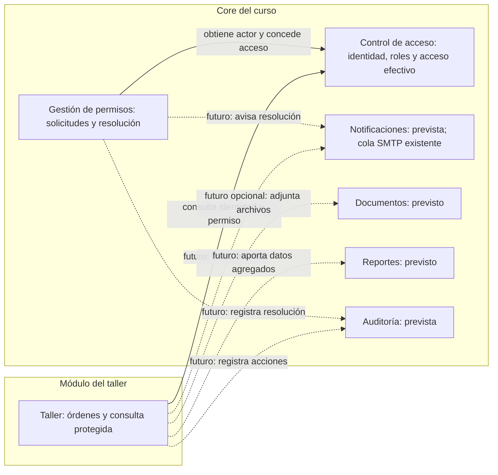

# TallerOS

Sistema de gestión para un solo taller de automóviles y motocicletas. Incluye Control de acceso, Gestión de permisos con pruebas unitarias y la estructura de estados de la orden de reparación. La API usa C# y ASP.NET Core 10, Entity Framework Core y SQLite. React se incorporará en una etapa posterior.

## Requisitos y ejecución desde un clon

1. Instala el SDK de .NET 10 y clona este repositorio. Ejecuta los comandos desde la raíz `TallerOs`.
2. Ejecuta `dotnet restore TallerOs.slnx` y `dotnet build TallerOs.slnx`.
3. En PowerShell, crea un Administrador inicial con un correo distinto del que usarás para probar el registro:

   ```powershell
   $env:ADMIN_EMAIL = Read-Host 'Correo del Administrador'
   $secure = Read-Host 'Contraseña del Administrador' -AsSecureString
   $env:ADMIN_PASSWORD = [System.Net.NetworkCredential]::new('', $secure).Password
   dotnet run --project src/TallerOs.Api --no-launch-profile -- bootstrap-admin
   Remove-Item Env:ADMIN_PASSWORD
   ```

   La contraseña debe tener al menos ocho caracteres, letras y números. Este comando solo crea el primer Administrador; si ya existe uno, no crea otro.

4. En la misma terminal, inicia la API:

   ```powershell
   $env:APP_BASE_URL = 'http://localhost:5000'
   dotnet run --project src/TallerOs.Api --no-launch-profile --urls http://localhost:5000
   ```

   Abre `http://localhost:5000/health`. Debe responder `{"status":"ok"}`. La base SQLite se crea en `data/talleros.db`, fuera del control de versiones. Al reiniciar la API conserva usuarios y correos. `DB_PATH` permite elegir otra ruta.

5. Abre **otra** terminal PowerShell en la raíz del repositorio para las peticiones. El correo se envía con el comando independiente `send-mail` descrito abajo.

## Variables de entorno

| Nombre | Para qué sirve |
| --- | --- |
| `DB_PATH` | Ruta opcional de la base SQLite; por defecto `data/talleros.db`. Usa la misma ruta en la API y en los comandos. |
| `APP_BASE_URL` | Dirección pública de la API usada en los enlaces de activación. |
| `ADMIN_EMAIL` | Correo del primer Administrador, usado solo por `bootstrap-admin`. |
| `ADMIN_PASSWORD` | Contraseña del primer Administrador, usada solo por `bootstrap-admin`. |
| `SMTP_HOST` | Servidor SMTP que entrega los correos. |
| `SMTP_PORT` | Puerto SMTP; por defecto 587. |
| `SMTP_USER` | Usuario de autenticación SMTP. |
| `SMTP_PASSWORD` | Contraseña de aplicación o credencial SMTP. |
| `SMTP_FROM` | Dirección remitente del correo. |

No coloques los valores en archivos versionados ni en commits. Para una cuenta Gmail personal, configura el servidor de Gmail y una contraseña de aplicación en tu entorno local; no uses la contraseña normal de la cuenta. La cuenta debe permitir enviar al correo que el evaluador elija.

### Envío de los correos pendientes

En la **segunda terminal**, define `SMTP_HOST`, `SMTP_PORT`, `SMTP_USER`, `SMTP_PASSWORD` y `SMTP_FROM` como variables de entorno con los datos de tu proveedor. Para Gmail personal con verificación en dos pasos y una [contraseña de aplicación](https://support.google.com/accounts/answer/185833), usa estos comandos de PowerShell. La dirección remitente debe ser la de esa misma cuenta:

```powershell
$env:SMTP_HOST = 'smtp.gmail.com'
$env:SMTP_PORT = '587'
$env:SMTP_USER = Read-Host 'Tu dirección de Gmail'
$env:SMTP_FROM = $env:SMTP_USER
$secure = Read-Host 'Contraseña de aplicación de Google' -AsSecureString
$env:SMTP_PASSWORD = [System.Net.NetworkCredential]::new('', $secure).Password.Replace(' ', '')
```

El puerto 587 usa STARTTLS. No pegues la contraseña en el chat ni la guardes en el repositorio. Define `DB_PATH` si cambiaste su ruta en la API. Luego ejecuta:

```powershell
dotnet run --project src/TallerOs.Api --no-launch-profile -- send-mail
```

Cuando termines la prueba, ejecuta `Remove-Item Env:SMTP_PASSWORD` en esa terminal.

El comando informa cuántos correos envió. Ejecutarlo otra vez debe informar cero si no hay nuevos pendientes. Si SMTP falla, el registro o la recuperación ya terminaron bien y el correo permanece pendiente; corrige la conexión y repite el comando. Para la demo, ejecútalo después de registro, reenvío, recuperación o restablecimiento forzado. La aplicación **no envía correo dentro de esas peticiones**.

## API y pasos para comprobar los criterios

Todas las peticiones JSON usan `Content-Type: application/json`. En PowerShell:

```powershell
$base = 'http://localhost:5000'
$email = Read-Host 'Correo propio para recibir activación'
$password = Read-Host 'Contraseña de prueba'
$body = @{ name = 'Usuario de prueba'; email = $email; password = $password } | ConvertTo-Json
Invoke-RestMethod "$base/api/access/register" -Method Post -ContentType 'application/json' -Body $body
```

Ejecuta `send-mail` y abre el enlace recibido. La ruta del enlace es `GET /api/access/activate?token=...`. Antes de abrirlo, `/api/access/login` debe rechazar la cuenta inactiva; abrirlo dos veces debe rechazar la segunda apertura.

### Rutas públicas

| Método y ruta | JSON o parámetro | Comprobación |
| --- | --- | --- |
| `POST /api/access/register` | `name`, `email`, `password` | RF-CA-01/02/14/15: correo único; hash con sal; contraseña mínima; nace inactiva y encola enlace. Repite el correo, usa una contraseña corta y un correo mal formado para ver rechazos controlados. |
| `GET /api/access/activate?token=...` | Token del correo | RF-CA-16: activa una sola vez; un enlace usado o vencido se rechaza. |
| `POST /api/access/resend-activation` | `email` | RF-CA-17: la respuesta es igual para correo existente o inexistente; el enlace anterior deja de servir. Ejecuta `send-mail` para recibir el nuevo. |
| `POST /api/access/login` | `email`, `password` | RF-CA-03/19: entrega `token`. Correo inexistente y contraseña errónea dan el mismo mensaje. Tras cinco errores consecutivos, la contraseña correcta también se rechaza durante 15 minutos. |
| `POST /api/access/forgot-password` | `email` | RF-CA-09/10: misma respuesta para correo existente o no. Encola un código de un solo uso que vence en 30 minutos. Ejecuta `send-mail`. |
| `POST /api/access/reset-password` | `code`, `newPassword` | RF-CA-11/12/14: usa el código recibido. Repetirlo falla; la contraseña antigua y las sesiones anteriores dejan de funcionar. |

Para iniciar sesión y guardar la credencial:

```powershell
$loginBody = @{ email = $email; password = $password } | ConvertTo-Json
$session = Invoke-RestMethod "$base/api/access/login" -Method Post -ContentType 'application/json' -Body $loginBody
$headers = @{ Authorization = "Bearer $($session.token)" }
Invoke-RestMethod "$base/api/access/me" -Headers $headers
```

### Rutas con sesión

| Método y ruta | JSON | Comprobación |
| --- | --- | --- |
| `GET /api/access/me` | — | RF-CA-07: devuelve usuario y rol; sin credencial válida devuelve 401. |
| `POST /api/access/logout` | `{}` | RF-CA-18: la misma credencial deja de servir tras el cierre. |
| `POST /api/access/change-password` | `currentPassword`, `newPassword` | RF-CA-22/12/14: la contraseña actual incorrecta se rechaza; al cambiarla caducan todas las sesiones anteriores. |

Envía la cabecera `Authorization: Bearer <token>` a todas estas rutas. Tras cambiar contraseña, inicia sesión otra vez para obtener una credencial nueva.

### Rutas de Administrador

Inicia sesión con el Administrador creado por `bootstrap-admin` y usa su token en la cabecera `Authorization`. Prueba **las mismas rutas con el token de un Estándar**: deben responder 403 incluso si construyes la petición manualmente.

| Método y ruta | Datos | Comprobación |
| --- | --- | --- |
| `GET /api/admin/users/` | — | RF-CA-04/05/06/21: lista ID, nombre, correo, rol y estado; no devuelve hashes ni tokens. |
| `PUT /api/admin/users/{id}/role` | JSON `{"role":"Administrator"}` o `{"role":"Standard"}` | RF-CA-08: solo el Administrador cambia roles. |
| `PUT /api/admin/users/{id}/enabled?enabled=false` | `{}` | RF-CA-20: desactiva al usuario; su sesión abierta deja de servir. Con `enabled=true` lo reactiva. Intentar desactivar el propio Administrador se rechaza. |
| `POST /api/admin/users/{id}/force-reset` | `{}` | RF-CA-13: invalida la contraseña y sesiones existentes; encola un código nuevo. Ejecuta `send-mail` para recibirlo. |

`AccessAuthorization.cs` declara en una sola tabla el rol exigido por **cada ruta**: pública, Estándar o Administrador. El middleware consulta esa tabla antes de ejecutar la operación. Una ruta de acceso nueva que no esté declarada se rechaza, de modo que no queda pública por accidente.

### Almacenamiento y cola

La base SQLite está en `data/talleros.db`. Comprueba que `Users.PasswordHash` no contiene la contraseña escrita y que dos usuarios con la misma contraseña tienen hashes distintos. `ActivationTokens`, `RecoveryCodes` y `Sessions` almacenan **hashes de los secretos**, no los valores entregados al usuario. `EmailOutbox` muestra los correos `Pending` y `Sent`; tras enviar, ejecutar de nuevo `send-mail` no vuelve a entregar los enviados. Puedes abrir la base con cualquier visor SQLite.

Para simular SMTP caído, registra un usuario sin ejecutar `send-mail` o configura temporalmente un servidor SMTP inaccesible antes de invocar el comando. El registro responde correctamente y el correo permanece `Pending`. Reinicia la API y vuelve a consultar los usuarios para comprobar RD-09.

## Componentes del Core y del negocio



Las flechas continuas representan conexiones implementadas y las punteadas conexiones futuras. La cola SMTP ya existe para activación y recuperación; las notificaciones internas todavía no están implementadas. Todo se ejecuta dentro de la misma aplicación.

Gestión de permisos está en `TallerOs.Domain/Permissions` y `TallerOs.Application/Permissions`. Sus contratos de acceso están en `TallerOs.Application/Access`; no conocen entidades del taller. El identificador `WorkOrders.Read` se registra en `Program.cs`. La consulta que lo consume pertenece a `TallerOs.Application/Workshop`. Los adaptadores de persistencia nuevos están en `src/TallerOs.Api/Infrastructure`; comparten el contexto existente para guardar resolución y concesión en una sola transacción. La separación física completa de infraestructura y del código heredado sigue pendiente.

## Máquina de estados del negocio

`WorkOrder` es la entidad central del taller. `Customer`, `Vehicle`, `WorkOrder` y `Diagnosis` están relacionados en el modelo persistente. Los cinco estados y las transiciones se declaran en `src/TallerOs.Api/Workshop/WorkOrder.cs`. Consulta [la tabla de transiciones](docs/maquina-de-estados.md). `Delivered` es terminal y `Received → InRepair` está prohibida explícitamente. Esta práctica no exige todavía las pruebas de la máquina.

## Pruebas

Desde la raíz de un clon con el SDK de .NET 10 y acceso a NuGet:

```powershell
dotnet test TallerOs.slnx
```

El comando restaura dependencias, compila los proyectos necesarios y ejecuta la suite xUnit de `tests/TallerOs.UnitTests`, sin iniciar la API, SQLite ni SMTP. Cada prueba prepara sus propios datos; las fases se distinguen por bloques en blanco y los nombres incluyen el requisito. Se comprueban estado y datos de resoluciones válidas, rechazo y conservación de datos ante operaciones prohibidas, permisos del actor, aislamiento de solicitudes y concesión automática. Las comprobaciones HTTP y de migraciones descritas abajo complementan la suite unitaria.

## Asignación 2: Gestión de permisos

La entidad registra solicitante, permiso, estado, creación UTC, responsable de resolución, fecha UTC de resolución y motivo de rechazo. Las transiciones se deciden en `PermissionRequestTransitions`: `Pending → Approved → Applied` y `Pending → Rejected`. La aprobación pasa por `Approved` dentro del caso de uso y responde `Applied`, después de guardar también la concesión. No existe una operación HTTP para aplicar manualmente o cambiar libremente el estado.

El único permiso solicitable por ahora es `WorkOrders.Read`: habilita consultar todas las órdenes mediante `GET /api/workshop/orders`. No cambia el rol ni concede administración de usuarios. Un Administrador ya tiene acceso a esa consulta. Con una base nueva, la lista estará vacía y responderá 200 si está autorizado; no se requiere crear órdenes para comprobar la concesión.

### Preparación de la comprobación

1. Ejecuta el arranque y `bootstrap-admin` de la sección inicial. La migración `AddPermissionRequests` se aplica al arrancar y agrega tablas sin eliminar datos anteriores. Para usar una base de demostración separada, define primero `$env:DB_PATH = 'data/asignacion2-demo.db'` y usa esa ruta también en los comandos.
2. Registra tres usuarios distintos con `/api/access/register`: A para aprobar, B para rechazar y C para comprobar resolución propia. Actívalos antes de iniciar sesión. Puedes usar el envío de correo ya documentado. Para una comprobación local sin SMTP, usa direcciones ficticias como `a@example.test`, abre tu SQLite con un visor, busca su fila en `EmailOutbox` y abre el enlace de activación de `Body`; no edites usuarios, estados ni concesiones directamente.
3. En una terminal para peticiones, prepara las cabeceras siguientes. Introduce los correos utilizados al crear las cuentas:

```powershell
$base = 'http://localhost:5000'
function Open-DemoSession {
    param([string]$Email)
    $securePassword = Read-Host 'Contraseña de esta cuenta' -AsSecureString
    $body = @{
        email = $Email
        password = [System.Net.NetworkCredential]::new('', $securePassword).Password
    } | ConvertTo-Json
    $session = Invoke-RestMethod "$base/api/access/login" -Method Post -ContentType 'application/json' -Body $body
    @{ Authorization = "Bearer $($session.token)" }
}
$adminHeaders = Open-DemoSession (Read-Host 'Correo del Administrador')
$userAHeaders = Open-DemoSession (Read-Host 'Correo del usuario A')
$userBHeaders = Open-DemoSession (Read-Host 'Correo del usuario B')
$userCHeaders = Open-DemoSession (Read-Host 'Correo del usuario C')
$permissionBody = @{ permission = 'WorkOrders.Read' } | ConvertTo-Json
```

PowerShell muestra un error al recibir los 400, 401, 403, 404 o 409 esperados; revisa el código HTTP y el mensaje. Estas peticiones negativas deben ejecutarse individualmente para continuar después del rechazo.

### RF-GP-01 y RF-GP-02: solicitudes y privacidad

```powershell
$requestA = Invoke-RestMethod "$base/api/permissions/requests" -Method Post -Headers $userAHeaders -ContentType 'application/json' -Body $permissionBody
$requestB = Invoke-RestMethod "$base/api/permissions/requests" -Method Post -Headers $userBHeaders -ContentType 'application/json' -Body $permissionBody
$requestC = Invoke-RestMethod "$base/api/permissions/requests" -Method Post -Headers $userCHeaders -ContentType 'application/json' -Body $permissionBody
Invoke-RestMethod "$base/api/permissions/requests/mine" -Headers $userAHeaders
Invoke-RestMethod "$base/api/permissions/requests/pending" -Headers $adminHeaders
Invoke-RestMethod "$base/api/permissions/requests/pending" -Headers $userAHeaders
```

La creación devuelve 201 y `Pending`. `requesterId` se toma de la sesión; enviar otro ID no permite suplantar al solicitante. `/mine` devuelve solo las solicitudes propias y `/pending` solo pendientes para Administrador. La última petición devuelve 403. No hay parámetros para pedir las solicitudes de otro usuario.

### RF-GP-03 y RF-GP-05: aprobación y efecto inmediato

Primero comprueba el 403 sin permiso; después aprueba con el Administrador:

```powershell
Invoke-RestMethod "$base/api/workshop/orders" -Headers $userAHeaders
Invoke-RestMethod "$base/api/permissions/requests/$($requestA.id)/approve" -Method Post -Headers $adminHeaders
Invoke-RestMethod "$base/api/workshop/orders" -Headers $userAHeaders
```

La aprobación devuelve `Applied`, `resolverId` y `resolvedUtc`. La consulta posterior devuelve 200 con la misma sesión de A. La resolución y la concesión se guardan juntas: un conflicto revierte ambas. En SQLite se puede inspeccionar `PermissionRequests` y `UserPermissions` sin modificarlas.

### RF-GP-04: rechazo con motivo

```powershell
Invoke-RestMethod "$base/api/permissions/requests/$($requestB.id)/reject" -Method Post -Headers $adminHeaders -ContentType 'application/json' -Body '{"reason":"   "}'
Invoke-RestMethod "$base/api/permissions/requests/mine" -Headers $userBHeaders
Invoke-RestMethod "$base/api/permissions/requests/$($requestB.id)/reject" -Method Post -Headers $adminHeaders -ContentType 'application/json' -Body '{"reason":"Acceso no requerido para sus funciones"}'
Invoke-RestMethod "$base/api/workshop/orders" -Headers $userBHeaders
```

El motivo vacío produce 400 y conserva `Pending`. Un motivo válido produce `Rejected`, responsable, fecha y `rejectionReason`. Se aceptan hasta 1000 caracteres y se quitan los espacios exteriores. B conserva el rechazo de acceso 403.

### RF-GP-06: transiciones prohibidas

```powershell
Invoke-RestMethod "$base/api/permissions/requests/$($requestA.id)/approve" -Method Post -Headers $adminHeaders
Invoke-RestMethod "$base/api/permissions/requests/$($requestB.id)/approve" -Method Post -Headers $adminHeaders
Invoke-RestMethod "$base/api/permissions/requests/mine" -Headers $userAHeaders
Invoke-RestMethod "$base/api/permissions/requests/mine" -Headers $userBHeaders
```

Las dos aprobaciones devuelven 409; A sigue `Applied` y B sigue `Rejected` con su resolución original. La suite también intenta `Rejected → Applied` directamente sobre la entidad y verifica el rechazo con conservación del estado y del motivo. Las operaciones concurrentes usan el estado original como token de concurrencia de EF Core; una resolución obsoleta no sobrescribe otra.

### RF-GP-07: nadie resuelve su propia solicitud

C creó su solicitud cuando era Estándar. Promuévelo con el Administrador para comprobar la regla sin que el rechazo se deba únicamente al rol:

```powershell
$userC = Invoke-RestMethod "$base/api/access/me" -Headers $userCHeaders
Invoke-RestMethod "$base/api/admin/users/$($userC.id)/role" -Method Put -Headers $adminHeaders -ContentType 'application/json' -Body '{"role":"Administrator"}'
Invoke-RestMethod "$base/api/permissions/requests/$($requestC.id)/approve" -Method Post -Headers $userCHeaders
Invoke-RestMethod "$base/api/permissions/requests/$($requestC.id)/reject" -Method Post -Headers $userCHeaders -ContentType 'application/json' -Body '{"reason":"Motivo de prueba"}'
Invoke-RestMethod "$base/api/permissions/requests/mine" -Headers $userCHeaders
```

Ambas resoluciones producen 403 y la solicitud sigue `Pending`. El rol se consulta en servidor en cada petición, por lo que la sesión existente de C refleja la promoción.

### RD-06, RD-07 y RD-09: seguridad, entrada y reinicio

```powershell
Invoke-RestMethod "$base/api/permissions/requests/mine"
Invoke-RestMethod "$base/api/permissions/requests/$($requestC.id)/approve" -Method Post -Headers $userBHeaders
Invoke-RestMethod "$base/api/permissions/requests" -Method Post -Headers $userBHeaders -ContentType 'application/json' -Body '{}'
Invoke-RestMethod "$base/api/permissions/requests" -Method Post -Headers $userBHeaders -ContentType 'application/json' -Body '{"permission":7}'
Invoke-RestMethod "$base/api/permissions/requests" -Method Post -Headers $userBHeaders -ContentType 'application/json' -Body '{"permission":"Administrator"}'
```

Se esperan 401 sin sesión, 403 para resolver como Estándar y 400 para entradas inválidas. Una solicitud con GUID válido inexistente devuelve 404 al intentar resolverla. El Administrador no crea solicitudes; una nueva solicitud por un permiso ya concedido devuelve 409.

Detén la API con Ctrl+C y vuelve a iniciarla con la misma `DB_PATH`. Consulta `/mine` con A y B y `/api/workshop/orders` con A: deben conservarse `Applied`, `Rejected`, el motivo, las fechas y la concesión. Las sesiones siguen funcionando mientras no hayan vencido o sido revocadas. Para repetir toda la demostración, usa otras cuentas o una nueva ruta de base de demostración; no borres la base habitual.

### Entrega de la Asignación 2

La entrega exige código, suite, README y [bitácora de sesión](docs/bitacora-asignacion-2.md) en el punto etiquetado `asignacion-2`. Una vez revisados, autorizados los commits y la publicación, comprueba el estado y crea/publica esa etiqueta sin mover las anteriores:

```powershell
git tag asignacion-2
git push origin asignacion-2
```

En Moodle corresponde entregar la URL del repositorio y `asignacion-2`. La implementación local por sí sola no acredita que la etiqueta ya esté publicada. Esta unidad no incluye auditoría completa, notificaciones de permisos, CI/CD ni la suite de estados del taller.

## Flujo Git de la práctica

Cada funcionalidad se desarrolla en una rama `feature/...`, con commits pequeños cuyo asunto está en imperativo y cita el requisito. Cada PR describe **Qué cambia, Por qué, Cómo probarlo y Qué NO incluye**. Los cuatro grupos mínimos son registro/activación, sesión, recuperación de contraseña y administración de usuarios. Tras fusionarlos a `main` y verificar todos los criterios:

```powershell
git switch main
git pull --ff-only
git tag practica-1
git push origin practica-1
```

En Moodle se entrega la URL del repositorio y el nombre `practica-1`. El evaluador usa ese punto etiquetado.
